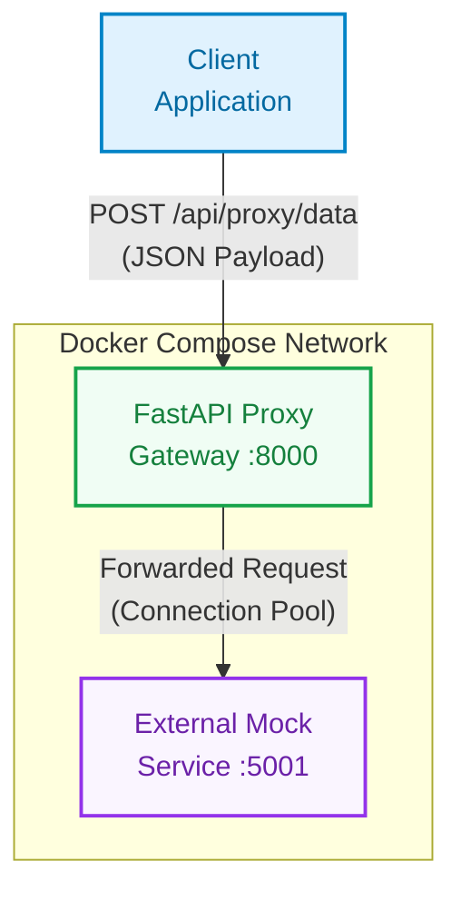
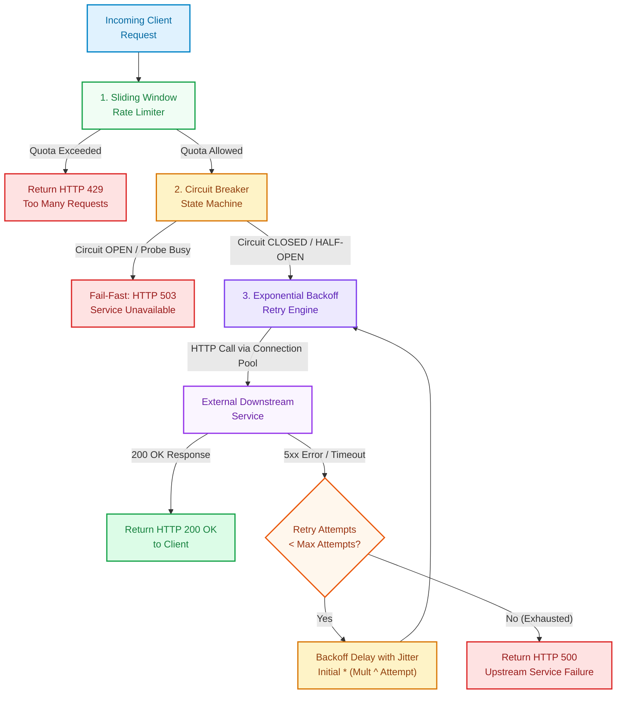
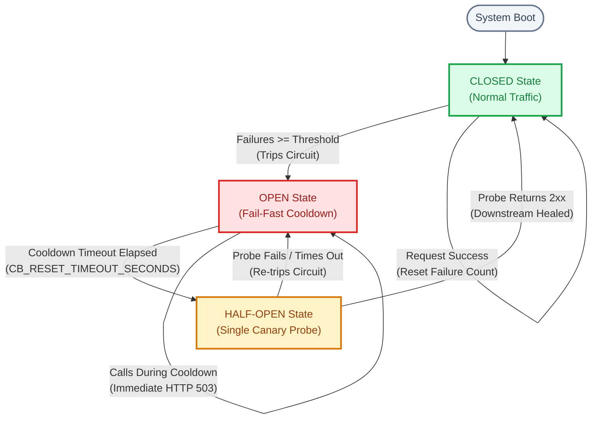
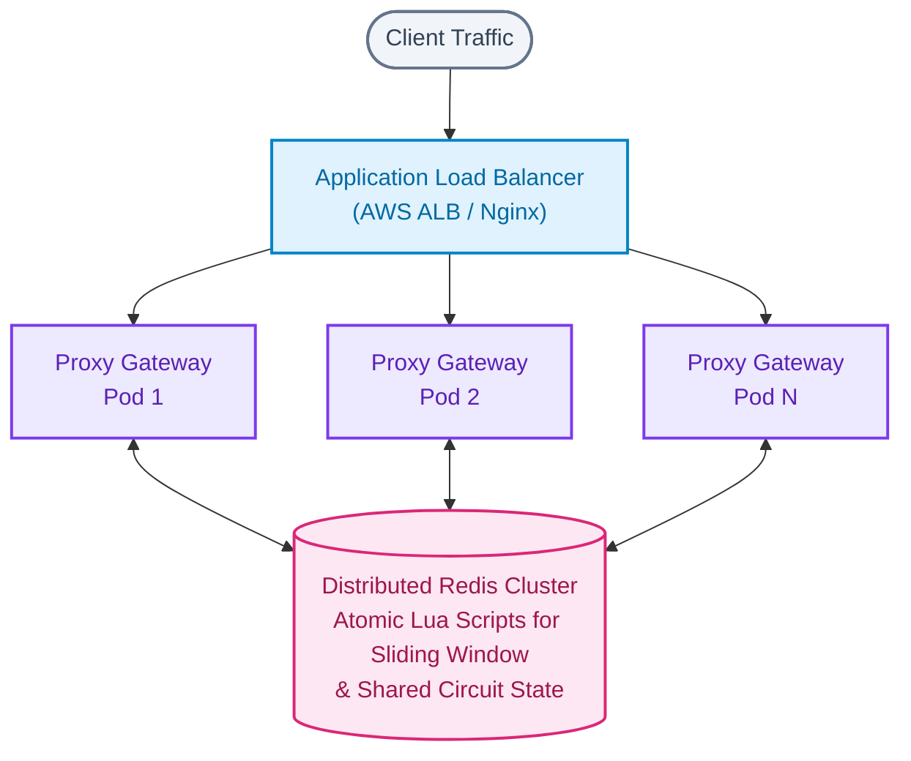

# Resilient External Service Proxy API

[](https://www.python.org/)
[](https://fastapi.tiangolo.com/)
[](https://docs.python.org/3/library/asyncio.html)
[](https://www.docker.com/)


A high-performance, fault-tolerant **API Gateway Reverse Proxy** built strictly from scratch with zero third-party resilience libraries. It safeguards downstream microservices, eliminates cascading failures, and stabilizes traffic across distributed cloud environments using **Sliding Window Log Rate Limiting**, a **Strict 3-State Finite State Machine Circuit Breaker**, and an **Exponential Backoff Retry Engine with Jitter**.

---

## 🏗️ Architecture Overview & Design Choices

The application is structured into two containerized microservices that communicate over an internal Docker network:



Every incoming client request is intercepted by a sequential, multi-layered resilience pipeline before touching the downstream service:



---

## ⚠️ The Distributed Systems Crisis & Real-World Context

In distributed cloud architectures, services communicate over unpredictable networks. When an external payment gateway, logistics API, or third-party provider degrades, a naive proxy that simply forwards requests causes catastrophic cascading outages:

### The 3 Stages of Naive Gateway Collapse:
1. **Upstream Degradation:** An external service latency jumps from 50ms to 5,000ms.
2. **Resource Exhaustion:** According to **Little's Law** ($L = \lambda \times W$), concurrent in-flight requests ($L$) stored in memory balloon by **100x**. Sockets hang in `TIME_WAIT` states and operating system file descriptors are exhausted.
3. **Platform Failure:** The gateway crashes under Out-Of-Memory (OOM) conditions. When it restarts, thousands of retrying clients trigger a **Thundering Herd / Retry Storm**, crushing the recovering service.

### 🌍 Real-World High-Stakes Use Cases:

| Industry Scenario | Problem Without Resilience Proxy | Protection Provided by Our Gateway |
|---|---|---|
| **💳 Payment Gateways**<br>*(Stripe, PayPal, Banking APIs)* | Checkout traffic surges during sales. Bank delays cause client sessions to freeze indefinitely, locking funds and losing customers. | • **Rate Limiting:** Enforces client tier quotas.<br>• **Circuit Breaker:** Fails fast (503) during outages.<br>• **Retries:** Masks transient packet drops. |
| **📦 SaaS & Logistics APIs**<br>*(FedEx, Twilio, OpenAI)* | Batch tracking jobs trigger sudden bill shock. Flaky endpoints exhaust host TCP sockets across thousands of calls. | • **Connection Pooling:** Reuses persistent HTTP keep-alive connections.<br>• **Fail-Fast:** Dispatches instant fallback webhooks. |
| **🕸️ Cloud Microservice Mesh**<br>*(Kubernetes Pods)* | One failing pod causes backpressure that cascades through the entire cluster, taking down unaffected services. | • **Fault Isolation:** Cuts off failing dependencies.<br>• **Full Jitter:** Decorrelates retries to eliminate retry storms. |

---

## 🧠 Algorithmic Deep Dive: Mathematical Rationale & Trade-offs

### 1. Sliding Window Log Rate Limiter vs. Fixed Window Counter

A common question in system design interviews is: *Why implement a Sliding Window Log rather than a standard Fixed Window Counter or Token Bucket?*

#### The Fixed-Window Boundary Burst Exploit (2x Quota Breach)
In fixed-window rate limiters, a window reset counter enables malicious or bursty clients to double their allowed throughput:
- **Window 1 (0:00 - 0:59):** Limit is 10 req/min. Client sends **10 requests at 0:59** *(Allowed)*.
- **Window 2 (1:00 - 1:59):** Window resets counter to 0! Client sends **10 requests at 1:01** *(Allowed)*.
- **Result:** **20 requests landed in a 2-second interval!** 200% of configured system capacity crushed the downstream service.

```
Fixed Window:   [ ... 0:59: 10 req ] | [ 1:01: 10 req ... ]  ==> 20 requests in 2 sec (BURST EXPLOIT!)
Sliding Window: [  Rolling 60-second window calculates actual timestamps  ] ==> Enforces strict quota
```

| Rate Limiter Algorithm | Memory Complexity | Burst Accuracy | Edge Boundary Safety | Implementation Complexity |
|---|---|---|---|---|
| **Fixed Window Counter** | $O(1)$ | Poor | ❌ Vulnerable to 2x burst exploit | Low |
| **Token Bucket** | $O(1)$ | Moderate | ⚠️ Allows sudden bucket bursts | Medium |
| **Sliding Window Log (Ours)** | $O(N)$ per client | **Perfect** | **Guaranteed zero boundary anomalies** | High (Requires timestamp log) |

#### Active Memory Eviction Mechanics:
In a standard sliding-window log, storing timestamp arrays for millions of one-off visitors causes memory leaks. Our implementation introduces **Active Key Eviction**:
```python
# From src/core/rate_limiter/sliding_window.py
valid_timestamps = [t for t in self.store[client_id] if t > cutoff]
if valid_timestamps:
    self.store[client_id] = valid_timestamps
else:
    # Key is actively evicted from memory to prevent unbounded memory leaks
    del self.store[client_id]
```

---

### 2. Strict 3-State Finite State Machine Circuit Breaker

The Circuit Breaker pattern manages three distinct states to protect vulnerable backends:



#### The Non-Blocking Lock Release Pattern (Event Loop Preservation)
In Python's asynchronous event loop, holding a lock while awaiting network I/O is a critical anti-pattern that serializes all traffic:

```python
# From src/core/circuit_breaker/state_machine.py
async with self.lock:
    # 1. State machine inspection and probe counter validation
    if self.state == CBState.OPEN:
        ...
# LOCK IS EXPLICITLY RELEASED HERE BEFORE AWAITING DOWNSTREAM NETWORK I/O!
try:
    result = await external_call_func()  # Non-blocking async network I/O
    async with self.lock:
        self.state = CBState.CLOSED      # 2. State transition on success
except Exception as e:
    async with self.lock:
        self.state = CBState.OPEN        # 3. State transition on failure
    raise e
```
- **Why this matters:** The event loop remains entirely unblocked for concurrent requests while still guaranteeing that only a single probe executes during `HALF-OPEN`.

---

### 3. The Mathematics of Exponential Backoff & Jitter

When a downstream service crashes, naively retrying every second exacerbates the outage. Retries must back off exponentially:

$$\text{Base Delay} = \left(\frac{\text{Initial Delay (ms)}}{1000}\right) \times (\text{Multiplier})^{\text{Attempt}}$$

#### Why Jitter is Non-Negotiable in Distributed Systems:
| Retry Approach | Timing Pattern | Distributed Failure Mode |
|---|---|---|
| **Deterministic Exponential** | Every instance sleeps the exact same duration: $100\text{ms}, 200\text{ms}, 400\text{ms}$. | 💥 **Retry Storm / Thundering Herd:** 1,000 instances retry at the identical millisecond, repeatedly knocking down the recovering backend. |
| **Exponential with Full Jitter** | $\text{Delay} = \text{random}(0.5 \times \text{Base}, \text{Base})$ | ✅ **Uniform Distribution:** Retries are decorrelated across instances, transforming traffic spikes into a smooth, manageable stream. |

---

### 4. Connection Pooling vs. Socket Exhaustion

Creating a new `httpx.AsyncClient` inside an endpoint handler creates a new OS socket on every request:
1. Under 1,000 requests/sec, the OS rapidly enters `TIME_WAIT` socket states.
2. The operating system runs out of ephemeral ports (`EADDRNOTAVAIL`).
3. Each connection performs redundant TCP 3-way handshakes and TLS handshakes.

**Our Implementation:**
In `src/main.py`, a singleton `httpx.AsyncClient` is created in FastAPI's `lifespan` context manager, reused across requests via `request.app.state.http_client`, and cleanly closed (`aclose()`) upon server shutdown.

---

## 🛡️ Failure Mode and Effects Analysis (FMEA Matrix)

| Failure Scenario | Downstream Condition | Naive Gateway Outcome | Resilient Proxy Behavior | Client HTTP Status |
|---|---|---|---|---|
| **Aggressive Scraping / Spikes** | Healthy (200 OK) | Downstream gets overwhelmed & crashes | Enforces sliding window quota; drops excess calls | `429 Too Many Requests` |
| **Complete Downstream Outage** | Unreachable / 503 | Gateway hangs; sockets exhaust; gateway crashes | Breaches failure threshold; trips Circuit Breaker to OPEN; fails fast | `503 Service Unavailable` |
| **Momentary Network Jitter** | Drops 1 in 10 packets | Client sees error and fails | Retry engine catches transient 5xx/timeouts with exponential backoff | `200 OK` (Masked from user) |
| **Invalid Client JSON / Bad ID** | Downstream returns 400 | Gateway wastes retries on permanent client error | Proxy identifies 4xx status; skips retries immediately | `400 Bad Request` |
| **Persistent Downstream Outage** | 500 Server Error | Infinite hanging requests | Retries up to max attempts; maps failure accurately | `500 Upstream Service Failure` |
| **Massive DDoS (1M unique IPs)** | Healthy | In-memory hashmap exhausts RAM (OOM Crash) | Active key eviction purges empty arrays immediately | `429` (When over quota) |

---

## 📁 Directory Structure

```
Resilient-Service-Proxy/
├── src/
│   ├── config/
│   │   └── settings.py          # Environment configuration loading & type validation
│   ├── core/
│   │   ├── circuit_breaker/
│   │   │   ├── __init__.py
│   │   │   └── state_machine.py # 3-state finite state machine with asyncio locks
│   │   ├── rate_limiter/
│   │   │   ├── __init__.py
│   │   │   └── sliding_window.py# Sliding-window log limiter with active memory eviction
│   │   ├── retry/
│   │   │   ├── __init__.py
│   │   │   └── backoff.py       # Exponential backoff retry engine with jitter
│   │   └── instances.py         # Thread-safe global singletons
│   ├── routes/
│   │   ├── health.py            # GET /health orchestration healthcheck
│   │   └── proxy.py             # POST /api/proxy/data pipeline coordinator
│   └── main.py                  # FastAPI application entrypoint & lifespan manager
├── external_mock_service/
│   ├── main.py                  # Downstream mock service (configurable latency & failures)
│   └── Dockerfile               # Mock service container specification
├── tests/
│   ├── test_rate_limiter.py     # Unit tests: quotas, sliding windows, memory eviction
│   ├── test_circuit_breaker.py  # Unit tests: state transitions & concurrent probe isolation
│   ├── test_retry.py            # Unit tests: exponential backoff, 4xx skips & jitter
│   └── test_integration.py      # End-to-end integration tests targeting live Docker containers
├── .env.example                 # Production configuration blueprint
├── docker-compose.yml           # Multi-container orchestration stack
├── Dockerfile                   # Proxy gateway container definition
└── README.md                    # In-depth architectural and developer documentation
```

---

## ⚙️ Environment Configuration

All resilience behaviors are configured via environment variables (defined in `.env.example` and injected via `docker-compose.yml`):

| Variable Name | Type | Default | Description |
|---|---|---|---|
| `EXTERNAL_SERVICE_URL` | String | `http://external-mock-service:5001/process` | Target downstream service endpoint |
| `RATE_LIMIT_WINDOW_SECONDS` | Integer | `60` | Rolling sliding window size in seconds |
| `RATE_LIMIT_MAX_REQUESTS` | Integer | `10` | Maximum requests permitted per client in window |
| `CB_FAILURE_THRESHOLD` | Integer | `5` | Consecutive failures required to trip circuit to OPEN |
| `CB_RESET_TIMEOUT_SECONDS` | Integer | `30` | Cooldown period before transitioning to HALF-OPEN |
| `RETRY_MAX_ATTEMPTS` | Integer | `3` | Maximum retry attempts per request |
| `RETRY_INITIAL_DELAY_MS` | Integer | `100` | Base exponential backoff delay in milliseconds |
| `RETRY_BACKOFF_MULTIPLIER` | Float | `2.0` | Exponential multiplier for backoff growth |

---

## 🚀 Getting Started & Orchestration

### Prerequisites
- Docker Engine & Docker Compose
- Python 3.12+ (for local development)

### 1. Launch with Docker Compose
Clone the repository and launch both the proxy gateway and downstream mock service with a single command:

```bash
docker-compose up -d --build
```

### 2. Verify Health Checks
Both services expose zero-overhead orchestration health check endpoints:
```bash
# Verify Proxy Service
curl -i http://localhost:8000/health
# Response: {"status": "healthy"} (HTTP 200 OK)

# Verify Downstream Mock Service
curl -i http://localhost:5001/health
# Response: {"status": "healthy"} (HTTP 200 OK)
```

### 3. Send Requests Through the Proxy Gateway
```bash
curl -X POST http://localhost:8000/api/proxy/data \
  -H "Content-Type: application/json" \
  -H "x-client-id: user-demo-1" \
  -d '{"message": "Hello Resilient World!", "fail_rate": 0.0}'
```

---

## 🧪 Comprehensive Testing Suite

```
Pytest Suite (13/13 Tests Passing)
  ├── 1. Unit Tests (Isolated Mocking)
  │     ├── test_rate_limiter.py    ──► Quotas, sliding window, active TTL memory eviction
  │     ├── test_circuit_breaker.py ──► CLOSED ➔ OPEN, probe canary, 1-probe concurrent lock
  │     └── test_retry.py           ──► Exponential backoff math, 4xx client bypass, jitter
  └── 2. Integration Tests (Live Docker Stack)
        └── test_integration.py     ──► 20 concurrent bursts (HTTP 429) & downstream trip (HTTP 503)
```

### Running Unit Tests Locally
Run isolated unit tests without requiring Docker containers:
```bash
# Install local dependencies
pip install fastapi uvicorn httpx pytest pytest-asyncio

# Execute test suite (13/13 passing)
python -m pytest tests/test_circuit_breaker.py tests/test_rate_limiter.py tests/test_retry.py
```

### Running Container Integration Tests
With the Docker containers running (`docker-compose up -d`), execute the live integration suite:
```bash
python -m pytest tests/test_integration.py
```
The integration suite automatically verifies:
- Burst concurrency of 20 simultaneous requests enforcing HTTP `429 Too Many Requests`.
- Injected downstream failure rates triggering the Circuit Breaker into `OPEN` state with HTTP `503 Service Unavailable`.

---

## 🔮 Production Evolution & Horizontal Scaling (Future Scope)

While in-memory storage provides microsecond execution speeds for a single node, enterprise cloud deployments distribute traffic across multiple Kubernetes pods behind an Application Load Balancer (ALB):



- **Atomic Redis Lua Scripts:** Sliding window logs can be stored in Redis Sorted Sets (`ZSET`), using `ZREMRANGEBYSCORE` to purge expired timestamps and `ZCARD` to evaluate quotas in a single atomic transaction.
- **OpenTelemetry & Prometheus:** Integrating metrics exporters for P99 latency, circuit breaker trip frequency, and rate-limit drops for real-time Grafana dashboards.
